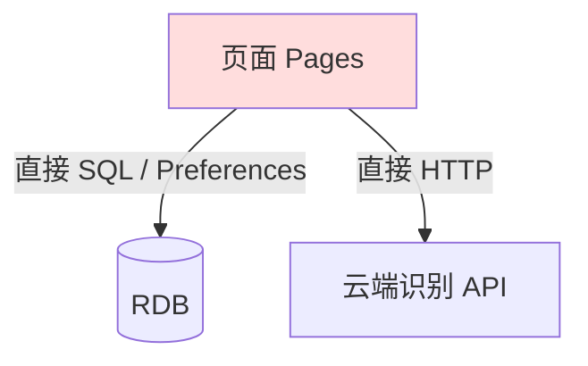
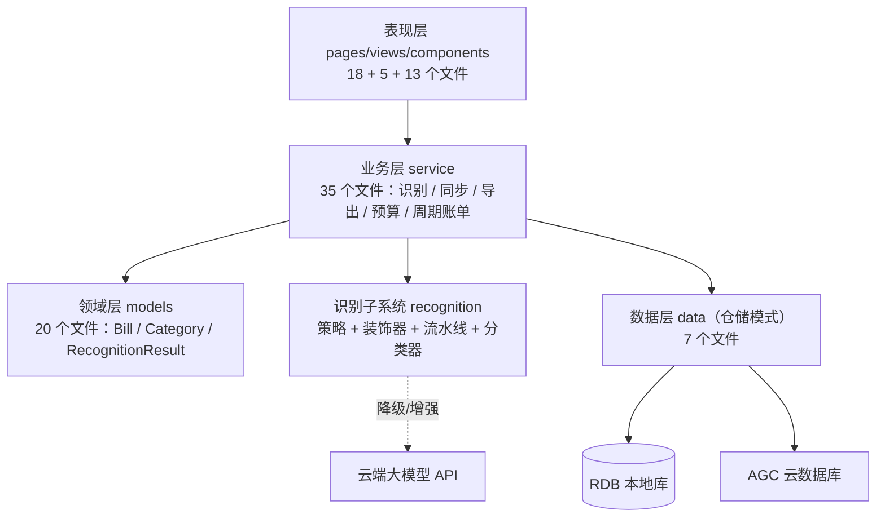
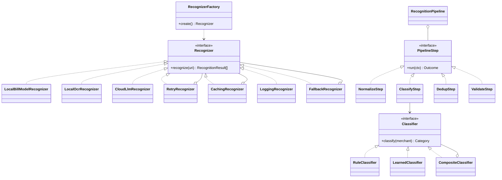
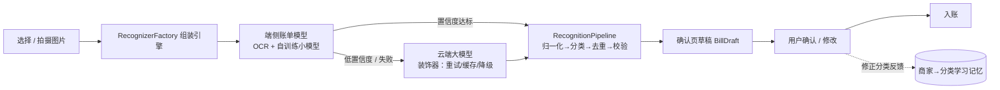

# 设计与重构报告

> 项目：基于多模态识别的智能记账本（HarmonyOS ArkTS）
>
> 本报告描述重构前后的系统结构、优化动机与思路、设计模式的应用，以及可度量的重构增益。

## 1. 背景与动机

本项目基于开源记账应用 [account_app_harmonyos](https://github.com/banggx)（Apache License 2.0，作者 banggx）二次开发。重构前（基线 commit `1110480`）存在以下问题：

1. **UI 与数据耦合**：页面直接操作数据库，业务逻辑散落在页面代码中，难以测试与复用；
2. **识别能力薄弱**：图片识别仅为简单的 OCR + 云端调用，无流水线、无降级策略、无可插拔性；
3. **无自动化测试、无 CI**：改动全靠人工回归；
4. **配置硬编码**：常量、偏好键、服务配置散落各处；
5. **录入成本高**：记账依赖手动输入，补记散落相册里的小票 / 支付截图费时费力。

重构目标：**分层解耦 + 引入「拍照一键记账」核心特性 + 用设计模式支撑识别子系统的可扩展性**。

## 2. 重构前后系统对比

### 2.1 重构前（基线，111 个文件 / 50 个 ArkTS 文件）



- 页面直接访问数据与网络，识别结果解析嵌在页面回调里；
- 识别引擎单一且不可替换，失败无降级；
- 无测试目录、无 CI 配置。

### 2.2 重构后（205 个文件 / 129 个 ArkTS 文件）



- **页面不再直接访问数据库**：统一经 `service` 调用 `data` 层仓储（`RdbAccountRepository` / `CloudAccountRepository` / `LedgerRepository` / `MerchantCategoryRepository`）；
- **识别逻辑全部移出页面**：页面只消费 `BillDraft` 草稿，识别细节封装在 `service/recognition`；
- **配置外置**：常量集中 `common/constants.ets` 与 `common/Config.ets`，云端服务商配置持久化在 Preferences，签名配置仅留本地不入库；
- **测试与 CI**：新增 `entry/src/ohosTest` 10 个测试文件，GitHub Actions 执行资源一致性检查。

## 3. 识别子系统设计（UML）

### 3.1 类图



### 3.2 识别流程



- **端云混合**：`FallbackRecognizer` 在端侧结果置信度低于阈值时自动降级云端；云端不可用 / 未配置时回退端侧，弱网可用；
- **装饰器叠加**：`RetryRecognizer`（指数退避重试）、`CachingRecognizer`（按图片内容哈希缓存）、`LoggingRecognizer`（日志）以装饰器形式任意组合，不改动核心识别逻辑；
- **流水线**：`NormalizeStep`（金额归一化）→ `ClassifyStep`（规则 + 学习分类器）→ `DedupStep`（金额 + 时间窗口 + 商家相似度查重）→ `ValidateStep`（字段校验），每步可独立测试；
- **自学习分类**：`CompositeClassifier` 组合 `RuleClassifier`（关键词规则）与 `LearnedClassifier`（商家→分类个人映射），用户每次修正都强化记忆。

## 4. 设计模式应用

| # | 设计模式 | 应用位置 | 解决的问题 |
| - | -------- | -------- | ---------- |
| 1 | **策略模式** | `Recognizer` 接口 + 3 个实现；`Classifier` 接口 + 3 个实现 | 识别 / 分类算法可互换，新增引擎不动调用方 |
| 2 | **工厂模式** | `RecognizerFactory` | 按用户配置组装识别引擎（端侧 / 云端 / 混合 + 装饰器），屏蔽构造细节 |
| 3 | **装饰器模式** | `RetryRecognizer` / `CachingRecognizer` / `LoggingRecognizer` | 不改核心逻辑叠加重试、缓存、日志能力，任意组合 |
| 4 | **责任链模式** | `PipelineStep` 流水线（归一化→分类→去重→校验） | 识别后处理步骤解耦、可插拔、单步可测 |
| 5 | **适配器模式** | `CloudResultParser`（大模型输出→结构化结果）、`VoiceBillParser`（语音文本→账单） | 统一不同输入源的输出格式为 `RecognitionResult` |
| 6 | **组合模式** | `CompositeClassifier` | 规则分类与学习分类按优先级统一调度，新增分类器无需改调用方 |
| 7 | **仓储模式** | `RdbAccountRepository` / `CloudAccountRepository` / `LedgerRepository` 等 | 隔离业务与存储，本地库与云数据库可互换、可测试 |
| 8 | **观察者模式** | `LedgerStore.notifyChanged()` 通知账本页刷新；`@StorageProp` 主题 / 断点全局联动 | 页面与数据变化解耦，跨页刷新不互相持有引用 |
| 9 | **单例模式** | `CloudLlmConfigStore` 等配置存储（`export default new X()`） | 全局唯一配置入口，避免多处读写下不一致 |

## 5. 重构增益量化

以基线 commit `1110480`（导入上游代码）与 `main` 对比：

| 度量项 | 重构前（基线） | 重构后 | 数据来源 |
| ------ | -------------- | ------ | -------- |
| 仓库文件数 | 111 | 205 | `git ls-tree -r --name-only` |
| ArkTS 文件数 | 50 | 129 | 同上 |
| 累计变更 | — | 157 个文件，+27,168 行 / −1,470 行 | `git diff --shortstat 1110480 main` |
| 单元测试文件 | 0 | 10（流水线各步骤 / 分类器 / 解析 / 装饰器 / 统计 / 去重） | `entry/src/ohosTest` |
| 设计模式 | 0（无接口抽象） | 9 种（见上表） | — |
| 持续集成 | 无 | GitHub Actions 资源一致性检查 | `.github/workflows/ci.yml` |
| 识别引擎 | 1 种（简单 OCR/云调用） | 3 种可插拔 + 4 个装饰器 + 流水线 | `service/recognition` |
| 端侧整笔交易识别 F1 | — | 0.753（留出测试集 226 笔真值；端云混合 0.948） | 见[量化实验报告](./量化实验报告.md) |

**新增功能**（重构同时交付）：图片识别记账（批量 / 去重 / 云端回退 / 确认页）、AI 助手语音记账、多账本、账单搜索、账单文件导入（支付宝 / 微信）、Word / PDF 导出、周期账单、月度预算、桌面小组件双布局、自定义主题、华为账号端云同步（双向合并 + 墓碑防复活）。

## 6. 安全与隐私

图片默认仅本地处理；上传云端需显式开启并单独授权；API Key 仅存本机不上云；本地 RDB 存储 + 删除墓碑机制保证同步一致性。详见[安全设计](./安全设计.md)。

## 7. 复现度量

```bash
# 文件与代码对比
git ls-tree -r --name-only 1110480 | wc -l
git diff --shortstat 1110480 main

# 分工度量
git shortlog -sn main
git log --author=<成员> --numstat --pretty=tformat: main
```
